# GreenHands

A tree-planting **volunteer registration and scheduling** web app.
Volunteers sign up, browse activities and register. Admins manage activities,
review registrations, and view reports and audit logs.

Built with **Python 3.12 / Flask / PyMySQL / MySQL (MariaDB via XAMPP) / Tailwind CSS**.
Design patterns: Singleton (`DatabaseManager`), MVC, Inheritance (`Person` -> `Volunteer` / `Admin`),
Template Method (`BaseReport`), DAO. See [REQUIREMENTS.md](REQUIREMENTS.md) for the
requirement-to-code map and [PROGRESS.md](PROGRESS.md) for status.

## Screenshots

| Volunteer | Admin |
|---|---|
| 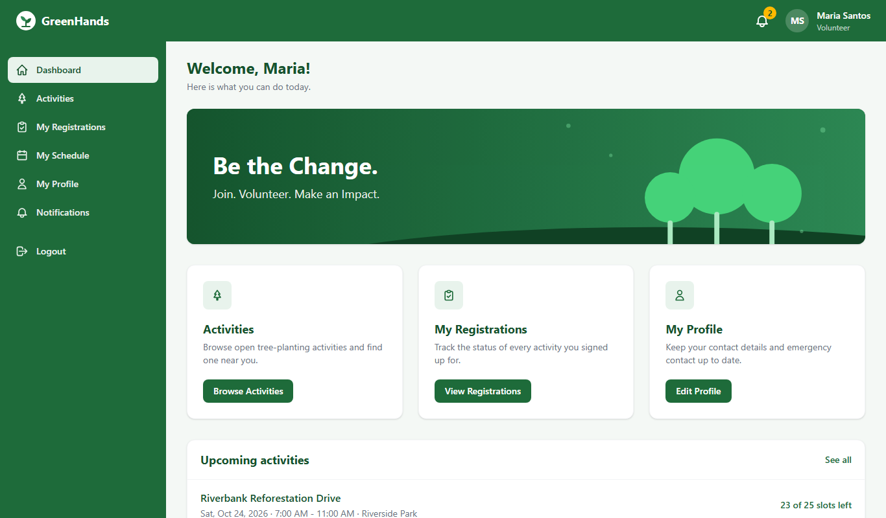 | 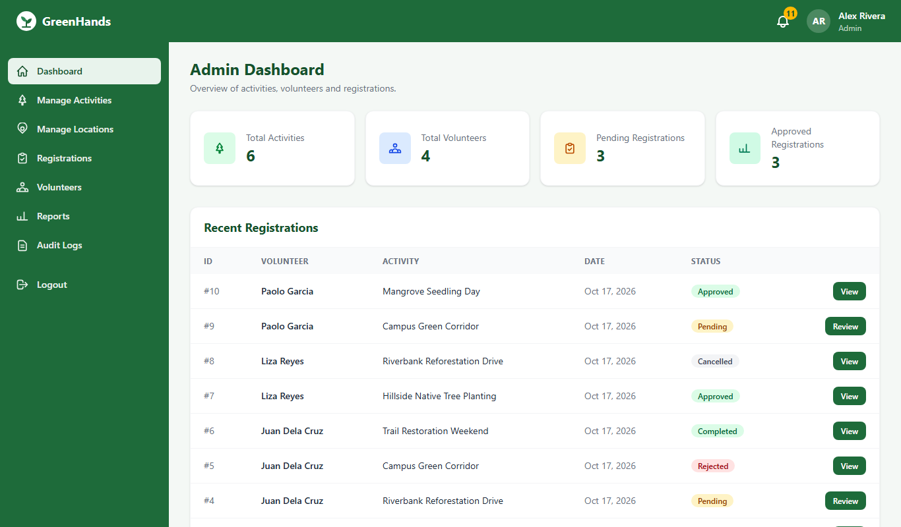 |
| 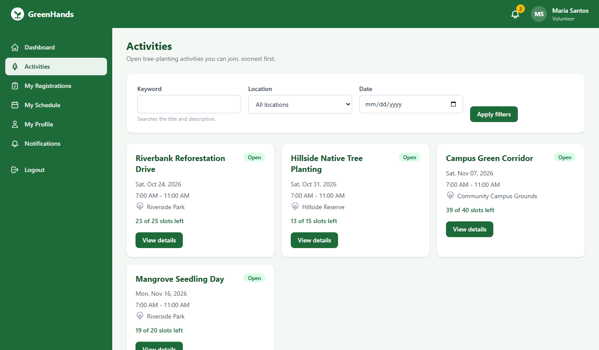 | 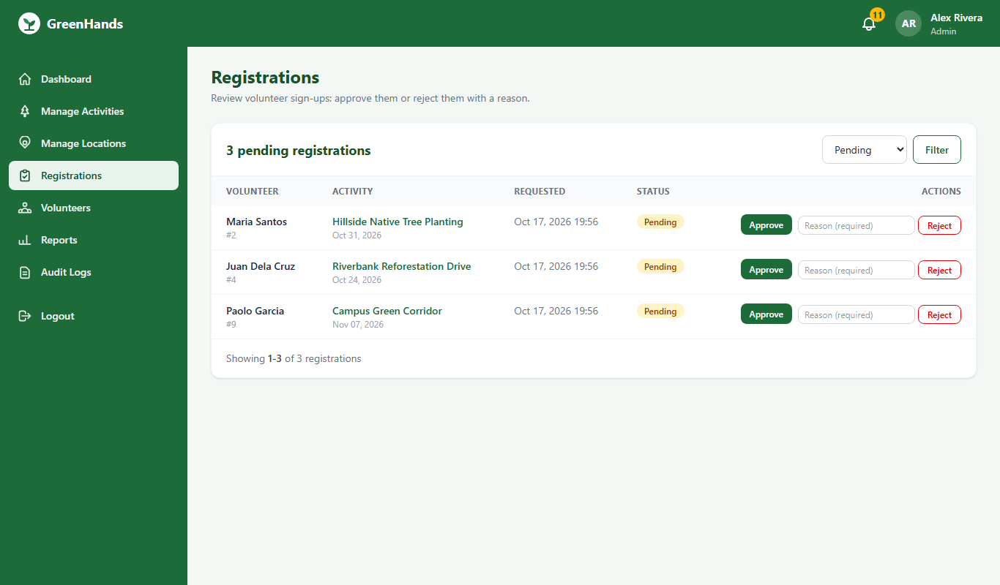 |
| 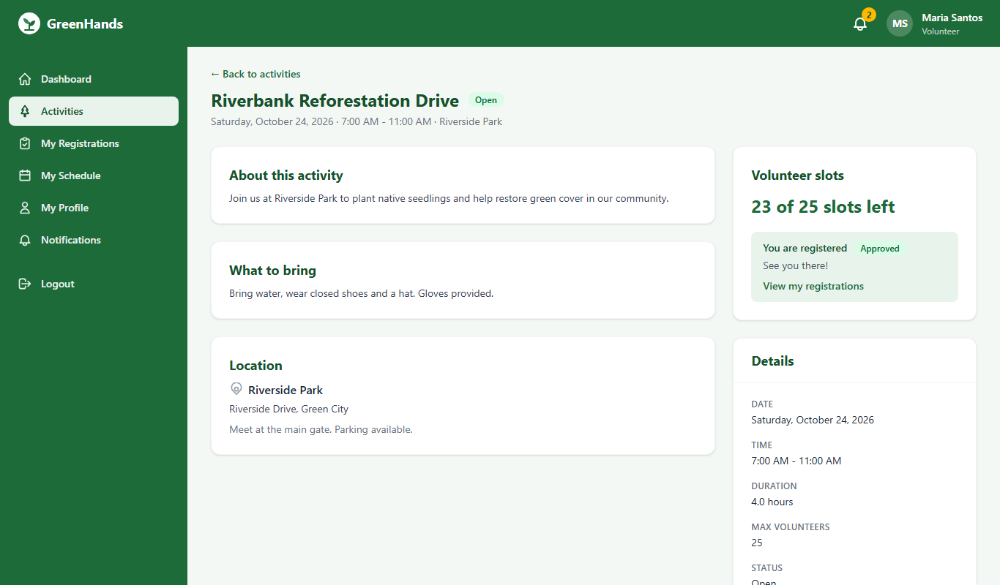 | 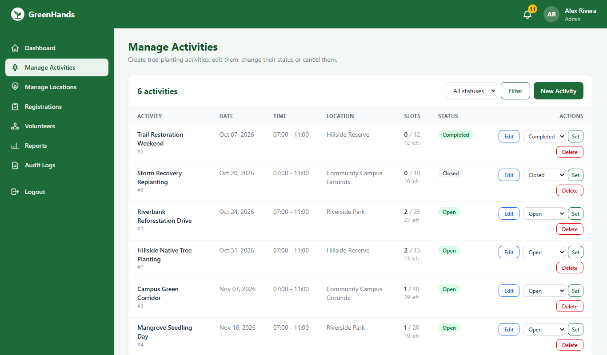 |
| 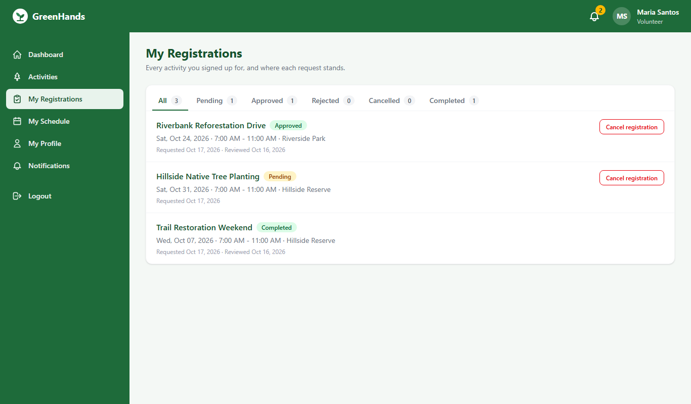 | 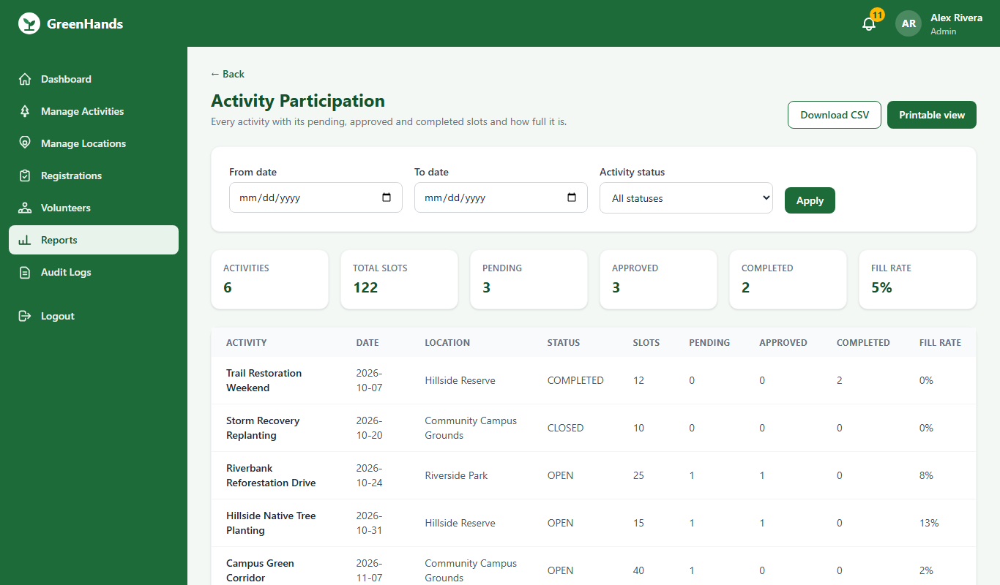 |
| 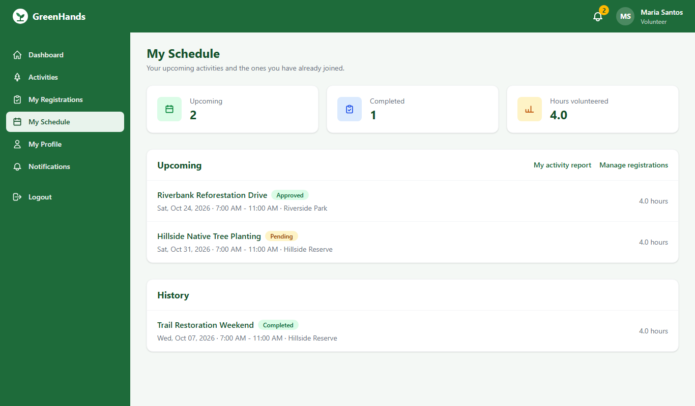 | 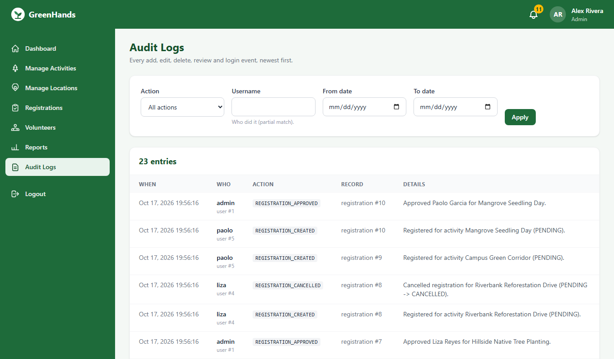 |

<p>
  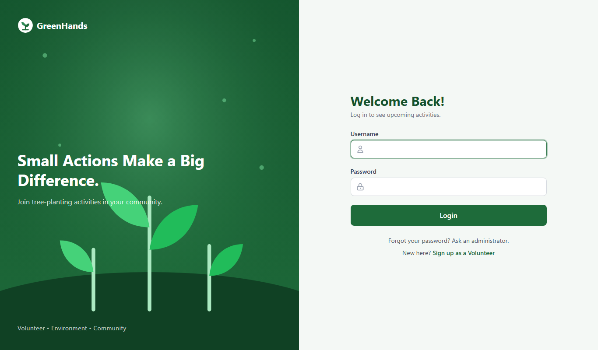
  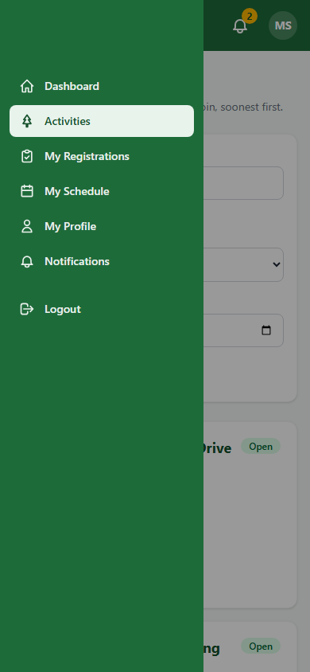
</p>

The images are produced by `python scripts\screenshots.py` against a throw-away demo
database, so they can be regenerated after any UI change.

## Documentation

- [docs/USER_GUIDE.md](docs/USER_GUIDE.md): how to use the application, page by page, for
  volunteers and administrators, with the messages you may see and what to do about them.
- [docs/DEMO.md](docs/DEMO.md): the 15-minute demo checklist for the defense, step by step,
  with the design pattern or requirement each step proves.
- [docs/DEPLOYMENT.md](docs/DEPLOYMENT.md): defense setup on XAMPP, what to change for a
  small production install, pre-launch checklist, backups.
- [REQUIREMENTS.md](REQUIREMENTS.md): every FR / NFR mapped to code and tests.
- [PROGRESS.md](PROGRESS.md): phase-by-phase status and how to resume work.

## Requirements

- Windows 11 with [XAMPP](https://www.apachefriends.org/) (MariaDB 10.4 or newer, phpMyAdmin)
- Python 3.12 (`py -3.12 --version`)
- Git, and the [GitHub CLI](https://cli.github.com/) if you want to open pull requests

## Setup (Windows / PowerShell)

```powershell
# 1. Clone and enter the project
git clone https://github.com/annnicoleborines/greenhand.git
cd greenhands

# 2. Create and activate a virtual environment, then install every dependency
py -3.12 -m venv venv
.\venv\Scripts\Activate.ps1
pip install -r requirements.txt

# 3. Create your .env from the example, then set SECRET_KEY to a long random value
Copy-Item .env.example .env
python -c "import secrets; print(secrets.token_hex(32))"   # paste the output into .env

# 4. Start XAMPP's MySQL from the terminal (same MariaDB as the Control Panel; the Control Panel's Start/Stop buttons still work too)
.\scripts\mysql.ps1                 # start; `.\scripts\mysql.ps1 stop` / `status` also work

# 5. Create the database and tables (choose ONE of the two ways below)
python scripts\init_db.py          # way A: Python script (creates greenhands + greenhands_test)

# 6. Load demo data (passwords come from the SEED_* values in .env)
python seed.py                     # add --big for 1,000 extra activities

# 7. Build the CSS (downloads the Tailwind standalone CLI once, no Node needed)
.\scripts\tailwind.ps1

# 8. Run the dev server
flask --app app run --debug
```

Open <http://127.0.0.1:5000>. Demo logins (after seeding): `admin` and `maria`,
with the passwords you put in `.env`.

### Way B: create the database in phpMyAdmin

1. Open <http://localhost/phpmyadmin> and click **New**.
2. Database name `greenhands`, collation `utf8mb4_unicode_ci`, click **Create**.
3. Select the database, open the **Import** tab, choose `database/schema.sql`, click **Go**.
4. Click the database name on the left: you should see 8 tables
   (`roles`, `users`, `volunteer_profiles`, `locations`, `activities`, `registrations`,
   `notifications`, `audit_logs`). Open `roles` to see the two rows `VOLUNTEER` and `ADMIN`.
5. Repeat steps 1 to 3 for `greenhands_test` if you want to run the integration tests.

`schema.sql` drops and recreates the tables, so importing it again wipes existing data.

### Already have a database? Upgrade it instead

After pulling new code, run `python scripts\upgrade_db.py`. It adds any new columns
(for example `users.photo_path` from Phase 2) to both `greenhands` and `greenhands_test`
and keeps your data. Running it twice is harmless; it prints "already up to date".

## Commands

| Task | Command |
|---|---|
| Activate venv | `.\venv\Scripts\Activate.ps1` |
| Install dependencies | `pip install -r requirements.txt` |
| Start / stop MySQL | `.\scripts\mysql.ps1` / `.\scripts\mysql.ps1 stop` (runs XAMPP's own mysqld; the XAMPP Control Panel works as well) |
| Create database + tables | `python scripts\init_db.py` (or import `database/schema.sql` in phpMyAdmin) |
| Upgrade an existing database after pulling | `python scripts\upgrade_db.py` (adds missing columns, keeps data) |
| Seed demo data | `python seed.py` (admin, 4 volunteers, 3 locations, 6 activities, 10 registrations in every status with notifications and audit trail; add `--big` for 1,000 more activities) |
| Dev server | `flask --app app run --debug` |
| Unit + integration tests | `pytest` |
| End-to-end tests (Phase 1+) | `playwright install chromium` once, then `pytest tests/e2e` |
| Lint | `ruff check .` |
| Format check / fix | `ruff format --check .` / `ruff format .` |
| Type check | `mypy .` |
| Everything CI runs | `.\scripts\check.ps1` |
| Build Tailwind CSS | `.\scripts\tailwind.ps1` (add `-Watch` while editing templates) |
| Regenerate README screenshots | `python scripts\screenshots.py` (rebuilds the scratch database `greenhands_demo`, seeds it, captures `docs/screenshots/*.png`) |

## Project layout (MVC)

```
app/
  __init__.py          Flask app factory (create_app) + error handlers
  config.py            settings loaded from .env
  errors.py            ValidationError, NotFoundError, ConflictError, ForbiddenError, DatabaseError
  extensions.py        Flask-Login, CSRF, rate limiter
  logging_config.py    JSON logger
  controllers/         CONTROLLER: Flask blueprints (thin: read request -> service -> template)
  templates/           VIEW: Jinja2 HTML
  static/src/          VIEW: Tailwind input (theme colours live here)
  models/              MODEL: BaseEntity, Person (abstract), Volunteer, Admin, Activity, ...
  services/            business rules; services/reports = BaseReport template method
  dao/                 DAO: one class per table, ALL SQL lives here (%s placeholders)
  database/            DatabaseManager singleton (connect, reconnect, transactions)
  schemas/             Pydantic validation
  auth/                password hashing, Flask-Login loader, role decorators
database/schema.sql    CREATE TABLE statements (import in phpMyAdmin)
scripts/               init_db.py, upgrade_db.py, tailwind.ps1 / .sh, check.ps1
instance/uploads/      profile photos uploaded by volunteers (git-ignored, created on first upload)
seed.py                demo data (through the DAOs)
tests/unit             no database (FakeDatabaseManager)
tests/integration      real MySQL/MariaDB test database
tests/e2e              Playwright browser tests
docs/design/           erd.png and reference.png (design references)
```

Request flow: **Controller -> Service -> DAO -> DatabaseManager -> MySQL**.
Controllers and templates never run SQL.

## Database notes

- All tables use **InnoDB** and **utf8mb4_unicode_ci** (named explicitly so the same
  `schema.sql` imports on MySQL 8 and MariaDB).
- Available slots are **computed** in the `ActivityDAO` query
  (`max_volunteers - count(PENDING + APPROVED)`), never stored.
- `CHECK` constraints guard `end_time > start_time` and `max_volunteers > 0`;
  `Activity.validate()` repeats the same rules in Python.
- Indexes exist on every foreign key and on the columns used by search and filters.
- XAMPP ships **MariaDB 10.4**. CI runs the same tests on **MySQL 8**, so both are covered.
- If MySQL is not running, pages show "Database is not available. Is MySQL running in XAMPP?"
  instead of crashing (FR-8).
- Profile photos are files, not database rows: they are saved as
  `instance/uploads/avatars/user_<id>.<ext>` (`UPLOAD_FOLDER` in `app/config.py`) and only
  `avatars/user_<id>.<ext>` is stored in `users.photo_path`. The folder is deliberately
  outside `app/static`, which Flask serves to anyone: photos are served by the
  login-protected route `/profile/photo/<path>` instead. The folder is git-ignored, so a
  fresh clone starts with no photos and users see their initials until they upload one.

## Tests

- `tests/unit` needs no database: DAOs are tested with a fake manager that records SQL.
- `tests/integration` uses `TEST_DB_NAME` from `.env`. It rebuilds that database from
  `schema.sql` once per run and empties the tables after every test. If MySQL is not
  reachable these tests are skipped, not failed. CI always runs them.
- `tests/e2e` drives a real Chromium browser (Playwright) against a Flask server started
  on a free port with CSRF enabled. They are not part of the plain `pytest` run; use
  `pytest tests/e2e` after `playwright install chromium`. They also skip when MySQL is down.

## Accessibility and responsive layout

- Every page has one `h1`, labelled form fields with inline error text (`aria-invalid`,
  `aria-describedby`), status badges with text (never colour alone), and `aria-current`
  on the active sidebar link.
- The first Tab reaches a "Skip to main content" link; the sidebar becomes a slide-in
  menu under 768 px with an `aria-expanded` toggle that also closes on Escape.
- Tables sit in horizontally scrolling cards, forms stack to one column on phones, and
  a submitted form disables its button so a request cannot be sent twice.
- Printable reports use a plain page without navigation (`print:hidden` toolbar).
- `tests/e2e/test_accessibility.py` checks the phone layout, the skip link and the
  loading state in a real browser.

## Line endings

`.gitattributes` forces LF for all text files. On Windows this works fine with the
default `core.autocrlf=true`; Git converts on checkout and commit.

## Image credits

The current images are hand-drawn SVG placeholders in `app/static/images` (no attribution
needed). Photos added in later phases will be credited here.
