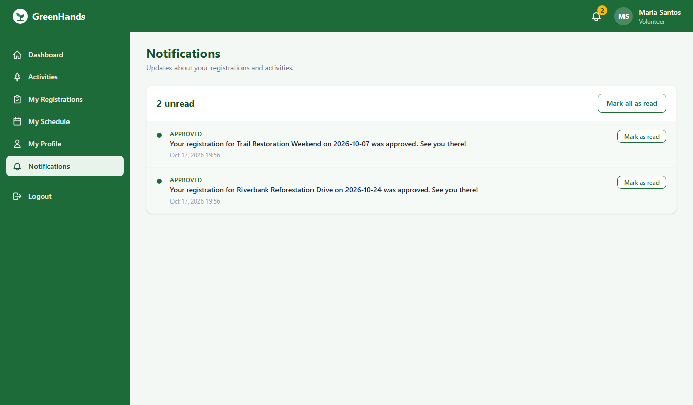

# GreenHands user guide

How to use the application, page by page, for the two kinds of users: **volunteers**
who join tree-planting activities and **administrators** who run them. For installing
and starting the application see the [README](../README.md); for the defense
walkthrough see [DEMO.md](DEMO.md).

The screenshots referenced below are in [`docs/screenshots/`](screenshots/).

---

## 1. Getting in

### Create a volunteer account
1. Open the application (http://127.0.0.1:5000 on the demo machine) and click **Sign up**.
2. Fill in username (3-50 letters, numbers or underscores), email, first and last name,
   and optionally phone and address.
3. Choose a password of at least 8 characters with at least one letter and one number,
   and repeat it. Errors appear under the field they belong to.
4. Press **Create account**. You are taken to the login page.

Administrator accounts are not created from the website; they come from the seed
script or from the database owner.

### Log in and out
- Enter your username and password on the login page. After **5 wrong passwords** the
  account is locked for **15 minutes**; the page tells you how long to wait.
- Forgot your password? Ask an administrator: they can give you a temporary password
  from the Volunteers page. Change it after you log in (My Profile -> Change password).
- **Logout** is the last entry in the sidebar.

### Finding your way around
- The green **sidebar** lists every page for your role. On a phone it is hidden behind
  the menu button at the top left; Escape closes it.
- The **bell** at the top right shows how many unread notifications you have and opens
  the Notifications page.
- Keyboard users: the first Tab on any page reaches **Skip to main content**.

---

## 2. Volunteers

### Dashboard
The three cards open Activities, My Registrations and My Profile. **Upcoming
activities** lists the three soonest open activities with their free slots.

### Activities (browse)

- Shows every **open** activity dated today or later, soonest first, 12 per page.
- Filter by **keyword** (title and description), **location** and **date**, then
  **Apply filters**. The filters live in the page address, so you can bookmark or share
  the list. **Clear** removes them.
- Each card shows date, time, location and **slots left** (or **Full**). **View details**
  opens the activity.

### Activity details and registering

- Read the description, what to bring, the location with its address, and the facts
  in the Details box. Slots are counted live from pending and approved registrations.
- Press **Register**. Your request is **Pending** until an administrator reviews it;
  the slot is held for you meanwhile. A message confirms it and the administrators are
  notified.
- The box tells you where you stand: *You are registered (Pending / Approved)*,
  *Your registration (Rejected / Completed)* with the administrator's remarks when
  rejected, or why you cannot register (full, closed, already started).
- You can register only once per activity. If you cancel, **Register again** appears
  while the activity is still open.

### My Registrations

- Tabs **All / Pending / Approved / Rejected / Cancelled / Completed** with counts.
- Each row links to the activity and shows the date, time, location, when you
  requested, when it was reviewed and any remarks.
- **Cancel registration** is offered only for pending or approved registrations whose
  activity has not started. You confirm in a dialog; the slot is freed, the
  administrators are notified, and you may register again later.

### My Schedule

- **Upcoming**: your pending and approved activities from today on, soonest first.
- **History**: activities that already took place or were marked completed, newest
  first. Rejected and cancelled registrations never appear here.
- The cards count upcoming and completed activities and your **hours volunteered**
  (approved or completed activities only).
- **My activity report** opens your personal report (see Reports below for CSV and
  print).

### My Profile
- **View** your contact details, address, birth date and emergency contact.
- **Edit Profile** to change them (names 1-50 characters, phone in a normal phone
  shape, birth date in the past and age 13 or more).
- **Change password**: enter the current password and the new one twice. The new
  password follows the sign-up rules and must differ from the current one.
- **Change Photo**: upload a PNG, JPG or WEBP up to 2 MB. The photo appears next to
  your name in the header; only logged-in users can see it.

### Notifications

- Newest first; unread rows are highlighted. You are told when a registration is
  **approved** or **rejected** (with the remarks), when an **activity is cancelled**,
  and when an administrator **resets your password**.
- **Mark as read** per row, or **Mark all as read** at the top.

---

## 3. Administrators

### Dashboard
Four cards (total activities, total volunteers, pending and approved registrations)
each open the matching list. **Recent Registrations** shows the newest sign-ups with a
**Review** button for pending ones.

### Manage Activities

- The list shows 10 activities per page with date, time, location, **slots taken / max**
  and status; filter it by status.
- **New Activity**: title, location (create locations first), date (today or later),
  start and end time (end after start), maximum volunteers (1-1000), optional
  description and requirements.
- **Edit** changes any field; the capacity can never drop below the slots already
  taken. Past activities can still be edited.
- **Set** a new status from the row (Open, Closed, Completed, Cancelled). **Closed**
  stops new registrations but pending ones can still be reviewed.
- **Delete** removes an activity nobody ever registered for. If anyone did register,
  the activity is **cancelled instead** and every pending or approved volunteer is
  notified. The row asks you to confirm.

### Manage Locations
- List with the number of activities at each location.
- **New Location** / **Edit**: name (unique, 2-100 characters), address, optional
  details such as a meeting point.
- **Delete** is refused while activities still use the location.

### Registrations (review)

- Opens on **Pending** requests, oldest first, 20 per page; the filter switches to
  another status or **All statuses**.
- **Approve** (confirm dialog): the activity's capacity is re-checked at that moment
  and the volunteer is notified. Approvals are refused when every slot is already
  approved or the activity is cancelled or completed.
- **Reject**: type the reason in the **Reason** box first; it is required and the
  volunteer reads it in their notification and on the activity page.
- A registration is reviewed once. A second Approve or Reject is refused with a message.

### Volunteers
- Search by name, username or email; 20 per page.
- **Deactivate** stops a volunteer from logging in (their session ends on the next
  request); **Activate** restores it. You cannot deactivate yourself or another
  administrator.
- **Reset password** shows a 12-character temporary password **once**. Give it to the
  volunteer and ask them to change it after logging in. The volunteer is also notified.

### Reports

- **System Totals**: activities, volunteers and registrations by status.
- **Activity Participation**: every activity with pending, approved and completed
  slots and its fill rate. Filter by activity date range and status.
- **Volunteer Hours**: every volunteer with registrations by status and the hours of
  the activities they were approved for or completed.
- Every report has **Download CSV** (opens in Excel; the filters you applied are kept)
  and **Printable view** (a plain page with a Print button and the active filters in
  the header).

### Audit Logs

- Every add, edit, delete, review, cancellation, lockout and password reset, newest
  first, 25 per page: when, who, the action code, the record and a short detail line.
- Filter by **action**, **username** (partial match) and **date range**.

### Notifications
Administrators are notified when a volunteer **registers** or **cancels**. The bell
and the Notifications page work the same as for volunteers.

---

## 4. Messages you may see

| Message | Meaning | What to do |
|---|---|---|
| Invalid username or password. | Wrong credentials (the page never says which). | Check both; after 5 failures wait 15 minutes. |
| This account is inactive. | An administrator deactivated the account. | Contact an administrator. |
| This activity is full. / Registration is closed. | No slot left, or the activity is not open or has started. | Pick another activity. |
| You are already registered for this activity. | One registration per volunteer and activity. | See My Registrations. |
| Only pending registrations can be reviewed. | Someone already approved or rejected it. | Refresh the list. |
| Remarks are required to reject. | The reason box was empty or too short. | Type 3-500 characters. |
| 403 Not allowed | The page belongs to the other role. | Use your own sidebar links. |
| 404 Not found | Old link or removed record. | Go back to the list. |
| 503 Database unavailable | MySQL is not running. | Start it (`.\scripts\mysql.ps1`) and refresh. |
